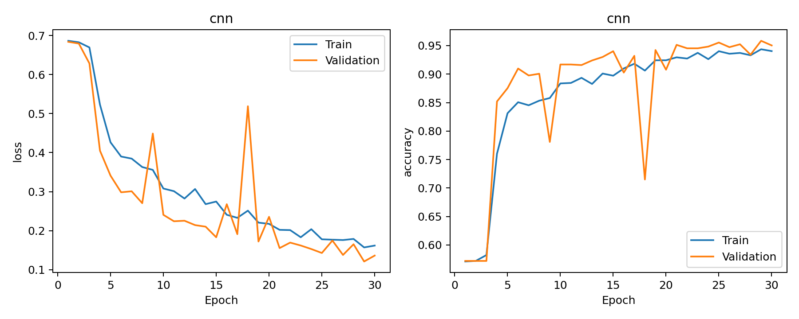
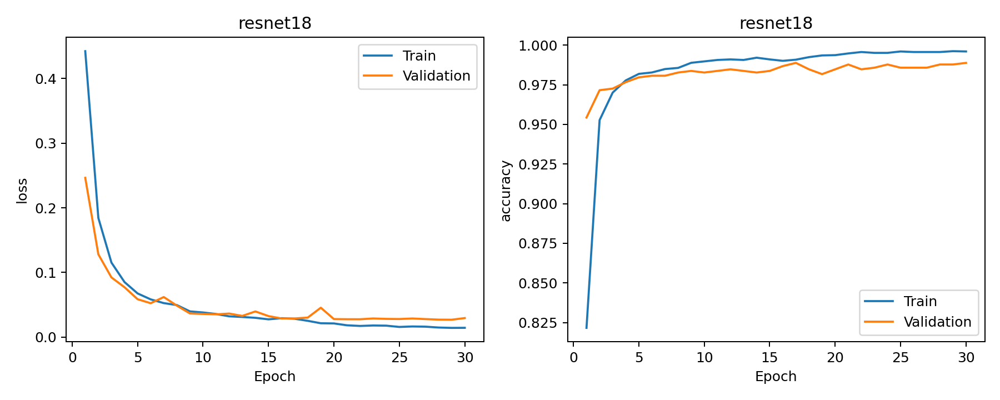
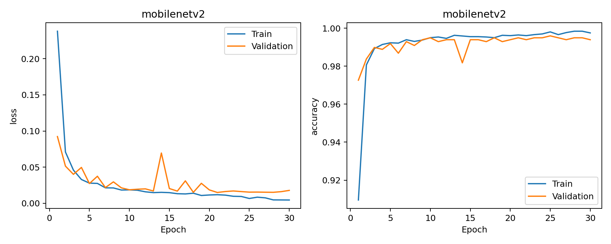

# Hướng dẫn hiểu và bảo vệ đề tài phân loại lỗi sản phẩm đúc

Tài liệu đọc thêm cho [README](README.md). Nội dung bám **báo cáo v4** ([bao_cao/baocaocodong_v4.docx](bao_cao/baocaocodong_v4.docx), 58 trang) và bộ kết quả [`casting_full_3models_01`](casting_full_3models_01/). Tài liệu dẫn theo **số mục, số hình, số bảng, số công thức** của báo cáo, không dẫn số trang.

Các câu nói mẫu dùng để luyện diễn đạt. Khi trình bày, hiểu ý rồi nói lại bằng lời của mình.

## 1. Nói rõ nhóm đã làm gì

> Nhóm nghiên cứu bài toán phân loại ảnh sản phẩm đúc thành hai lớp lỗi và đạt yêu cầu. Nhóm xây dựng một CNN đơn giản làm mô hình cơ sở, sau đó so sánh với ResNet-18 và MobileNetV2 dùng trọng số ImageNet. Ba cấu hình được đánh giá trên cùng tập test. MobileNetV2 được chọn theo validation loss. Ứng dụng demo cho chạy riêng hoặc so sánh cả ba mô hình.

Đầu vào là ảnh của một sản phẩm. Đầu ra là nhãn lỗi hoặc đạt. Đây là bài toán phân loại toàn ảnh, không xác định vị trí hay loại khuyết tật (mục 2.1).

Phần nhóm thực hiện gồm kiểm tra ảnh trùng, chia train/validation, xây dựng CNN và đầu phân loại cho hai mô hình học trước, huấn luyện ba cấu hình, chọn checkpoint, đánh giá, phân tích ảnh sai, kiểm chứng sau nạp và làm demo. Dữ liệu (Kaggle) và các kiến trúc ResNet-18, MobileNetV2 (Keras) có nguồn bên ngoài.

Theo bảng **Phân công nhiệm vụ** của báo cáo:

| Thành viên | Nhiệm vụ | Phần nên trình bày |
|---|---|---|
| Nguyễn Quang Minh | Lý thuyết; phát biểu bài toán và CNN baseline; huấn luyện ResNet-18, MobileNetV2; đánh giá và so sánh; viết báo cáo | 2.1, 2.3, 2.4, 3.1, 3.3, 3.4 |
| Nông Hữu Thịnh | Lý thuyết; thu thập và tiền xử lý dữ liệu; viết báo cáo | 2.2, 3.2 và một phần Chương 1 |
| Vũ Ngọc Quý | Lý thuyết; đánh giá và so sánh; phân tích ảnh sai và hạn chế; lưu mô hình và demo; viết báo cáo | 3.4, 3.5 |

Hội đồng có thể hỏi bất kỳ ai về bất kỳ phần nào. Mỗi người cần nắm cả mục 2 đến mục 6 dưới đây.

## 2. Giải thích Chương 2

### 2.1. Phát biểu bài toán và đầu ra (mục 2.1)

Với mỗi ảnh, mô hình tạo một số `p_ok` trong khoảng 0 đến 1 theo công thức (2.1). Nhãn quy ước là 0 cho ảnh lỗi và 1 cho ảnh đạt (Bảng 2.1). Với ngưỡng 0,5, `p_ok` từ 0,5 trở lên là đạt, dưới ngưỡng là lỗi. Ngưỡng này tương đương chọn lớp có điểm lớn hơn giữa `p_ok` và `1 − p_ok`; bằng nhau thì gán đạt.

Mỗi mô hình được huấn luyện để cực tiểu binary cross-entropy trên train, công thức (2.2) và (2.3). Trong 30 epoch, nhóm giữ trạng thái có validation loss thấp nhất làm checkpoint, thay vì trạng thái có train loss nhỏ nhất, để hạn chế quá khớp.

Điểm đầu ra cao vẫn có thể đi kèm dự đoán sai, như ảnh `cast_def_0_150.jpeg` ở mục 3.5.1. Điểm 0,998192 của một ảnh demo khác với accuracy 99,44% tính trên 715 ảnh test.

**Câu nói mẫu**

> Đầu ra sigmoid là điểm của lớp đạt. Nhóm dùng cùng ngưỡng 0,5 cho cả ba mô hình để tạo nhãn và so sánh.

### 2.2. Thu thập và tiền xử lý dữ liệu (mục 2.2)

Ba vai trò của các tập (Bảng 2.2):

- **Train** cập nhật trọng số.
- **Validation** dùng cho ReduceLROnPlateau, chọn checkpoint và chọn mô hình đề xuất.
- **Test** đánh giá các checkpoint sau khi lựa chọn đã chốt.

Nguồn có 7.348 ảnh JPEG 300 × 300: thư mục train 6.633 ảnh, thư mục test 715 ảnh. Ảnh lưu ba kênh nhưng ba kênh bằng nhau, khi đọc được chuyển về ảnh xám một kênh (mục 2.2.1).

Kiểm trùng (mục 2.2.2): băm SHA-256 trên kích thước và pixel ảnh xám **trước resize**; đọc test trước train để ưu tiên giữ test. Kết quả ở mục 3.2: **64 ảnh đạt** trong train trùng pixel với ảnh test cùng lớp, bản ở train bị loại; không ảnh hỏng, không trùng nào khác. Còn 6.569 ảnh train sạch, tách 15% làm validation, chia phân tầng, seed 42 (mục 2.2.3).

| Tập (Bảng 3.1) | Ảnh lỗi | Ảnh đạt | Tổng |
|---|---:|---:|---:|
| Train | 3.194 | 2.389 | 5.583 |
| Validation | 564 | 422 | 986 |
| Test | 453 | 262 | 715 |
| Tổng | 4.211 | 3.073 | 7.284 |

Tỷ lệ ảnh lỗi ở train và validation đều khoảng 57,2%; ở test khoảng 63,4% vì test giữ cách chia của nguồn.

**Câu nói mẫu**

> Nhóm giữ nguyên tập test của nguồn. Sau khi loại 64 bản sao ở train, nhóm tách validation để theo dõi huấn luyện. Cả ba mô hình dùng chung danh sách ảnh ở mỗi tập.

Khi được hỏi về độc lập dữ liệu, trả lời đúng phạm vi đã kiểm tra. Sau xử lý, ba tập không còn ảnh trùng pixel. Bộ nguồn đã có augmentation, nên phép kiểm tra đó chưa bắt được ảnh biến đổi gần giống hoặc ảnh cùng một sản phẩm (mục 3.5.4).

**Đầu vào từng mô hình (mục 2.2.4, Bảng 2.3).** Ảnh xám được resize bilinear bằng Pillow về 256 × 256. CNN nhận trực tiếp và chuẩn hóa `x/255`. Với ResNet-18 và MobileNetV2, ảnh tiếp tục được resize bằng `tf.image.resize` (bilinear, antialias) về 224 × 224 rồi lặp thành ba kênh. ResNet-18 chuẩn hóa `(x/255 − μ)/σ` theo ImageNet; MobileNetV2 chuẩn hóa `x/127,5 − 1`. Chuẩn hóa đặt trong mô hình để lưu cùng tệp `.keras`.

**Vì sao dùng ảnh xám, resize?**

> Ảnh nguồn có ba kênh bằng nhau, nên chuyển về một kênh không mất thông tin. Kích thước cố định giúp thống nhất đầu vào. Hai backbone cần 224 × 224 × 3 nên nhóm lặp kênh xám. Nhóm chưa so sánh nhiều kích thước để chọn phương án tối ưu; thu nhỏ ảnh có thể làm mờ vết lỗi rất nhỏ.

Nguồn đã có augmentation. Pipeline không thêm augmentation, nên ba cấu hình học trên cùng tập train cố định. Kết quả chưa đo riêng tác dụng của augmentation.

### 2.3. Mô hình sử dụng (mục 2.3)

Cả ba mô hình thuộc họ mạng tích chập. "CNN" trong bảng kết quả là tên gọn của mạng nhóm xây làm baseline.

**CNN học từ đầu (mục 2.3.2, Bảng 2.4, Hình 2.2)**

1. Rescaling đưa pixel từ 0–255 về 0–1.
2. Ba tầng Conv2D với 32, 64, 128 bộ lọc 3 × 3, stride 1, padding same, ReLU.
3. Sau mỗi Conv là MaxPooling 2 × 2, stride 2: kích thước 256 → 128 → 64 → 32.
4. Global Average Pooling: 32 × 32 × 128 → 128 giá trị.
5. Dense 64 + ReLU phối hợp đặc trưng.
6. Dropout 0,3 chỉ hoạt động khi huấn luyện.
7. Dense 1 + sigmoid tạo `p_ok`, công thức (2.4).

Tổng 100.993 tham số, toàn bộ được học: 320 + 18.496 + 73.856 (ba Conv) + 8.256 + 65 (hai Dense). Mỗi lần kích thước không gian giảm một nửa, số bộ lọc tăng gấp đôi; tầng Conv thứ hai và thứ ba cùng cần khoảng 302 triệu phép nhân–cộng cho một ảnh. Nếu thay GAP bằng Flatten, Dense 64 cần 8.388.672 tham số thay vì 8.256.

Kiến trúc dùng các lớp CNN thông dụng, nhóm chọn và ghép cho bài toán. Đóng góp nên trình bày ở quy trình thực nghiệm và kết quả, không nhận là phát minh kiến trúc mới.

**ResNet-18 và MobileNetV2 (mục 2.3.3, 2.3.4)**

Backbone là phần trích xuất đặc trưng. Hai backbone đã học trên ImageNet, được đặt `trainable=False` và gọi với `training=False`, nên trọng số và thống kê Batch Normalization giữ nguyên. Nhóm thêm GAP → Dense 64 → Dropout 0,3 → Dense 1 sigmoid. Đây là trích đặc trưng cố định, **không phải fine-tuning**.

Lý do đóng băng (mục 2.3.1): tập train chỉ khoảng 5.600 ảnh, và mục tiêu là đo mức đóng góp của đặc trưng ImageNet với chi phí huấn luyện thấp. Fine-tuning để lại cho thực nghiệm sau.

| Cấu hình (Bảng 2.7) | Tổng tham số | Tham số được huấn luyện |
|---|---:|---:|
| CNN | 100.993 | 100.993 |
| ResNet-18 | 11.219.009 | 32.897 |
| MobileNetV2 | 2.340.033 | 82.049 |

**Vì sao MobileNetV2 ít tham số tổng hơn ResNet-18 nhưng tham số học lại nhiều hơn?**

> MobileNetV2 nhẹ (khoảng 2,34 triệu tham số) nhờ tích chập tách biệt theo chiều sâu. Nhưng trước GAP, MobileNetV2 có 1.280 kênh đặc trưng, ResNet-18 chỉ có 512.
> Dense 64 của MobileNetV2 nhận 1.280 đầu vào: (1.280 + 1) × 64 = 82.048, cộng 65 của Dense 1 thành **82.049**. Của ResNet-18: (512 + 1) × 64 = 32.832, cộng 65 thành **32.897**.

**Khối inverted residual của MobileNetV2 khác basic block của ResNet-18 thế nào?**

> ResNet-18 dùng **basic block** (Hình 2.3): hai Conv 3 × 3 kèm Batch Normalization, **giữ nguyên số kênh** (ví dụ 64 → 64), cộng với đầu vào qua đường nối tắt rồi ReLU: y = ReLU(F(x) + x). Khi đổi số kênh hoặc độ phân giải, đường tắt dùng phép chiếu.
> MobileNetV2 dùng **inverted residual** (Hình 2.5, ví dụ block_7): Conv 1 × 1 mở rộng 64 → 384 kênh, depthwise 3 × 3 lọc riêng từng kênh, Conv 1 × 1 chiếu tuyến tính về 64 kênh (không ReLU), rồi cộng với đầu vào. Hẹp ở hai đầu, rộng ở giữa (mỏng → dày → mỏng). Tích chập tách biệt cần ít phép tính hơn Conv 3 × 3 thường khoảng 8–9 lần.
> Kiểu "dày → mỏng → dày" là bottleneck của ResNet-50 trở lên, **không phải** ResNet-18. Đừng nhầm khi trả lời.

**Câu nói mẫu**

> Với CNN, nhóm học toàn bộ trọng số từ đầu. Với hai mô hình học trước, nhóm giữ cố định phần trích xuất đặc trưng và chỉ học đầu phân loại mới. Vì vậy kết quả so sánh phản ánh cả kiến trúc, trọng số học trước và độ phân giải đầu vào của từng cấu hình.

Đóng băng giữ nguyên trọng số backbone, còn phép tính đặc trưng vẫn chạy cho mọi ảnh. Đó là lý do ResNet-18 học ít tham số nhất mà thời gian huấn luyện dài nhất (990,97 giây, mục 3.3.3).

### 2.4. Huấn luyện, đánh giá và lựa chọn (mục 2.4)

Thiết lập chung (Bảng 2.8): 30 epoch, batch 32, Adam với learning rate khởi đầu 0,001, binary cross-entropy, seed 42, ReduceLROnPlateau (hệ số 0,5, patience 3, tối thiểu 10⁻⁶), checkpoint theo validation loss thấp nhất, **tắt early stopping**, TerminateOnNaN, ngưỡng `p_ok ≥ 0,5` → đạt. Không dùng class weight, L1/L2 (mục 2.4.2).

- Một epoch là một lượt qua 5.583 ảnh train, gồm ⌈5.583 / 32⌉ = 175 lần cập nhật.
- Adam điều chỉnh bước riêng cho từng tham số dựa trên trung bình trượt của gradient và bình phương gradient. Giá trị 0,001 là mặc định do tác giả Adam đề xuất.
- BCE phạt mạnh khi xác suất gán cho nhãn thật tiến về 0. Vì vậy accuracy và loss đo hai khía cạnh khác nhau.
- ModelCheckpoint lưu trạng thái có validation loss nhỏ nhất; CSVLogger ghi loss và accuracy từng epoch.
- **Vì sao tắt early stopping** (mục 2.4.3): để lưu đủ 30 epoch cho cả ba cấu hình. Việc giữ checkpoint có validation loss thấp nhất đã đóng vai trò chọn điểm dừng.

**Tiêu chí đánh giá (mục 2.4.4, Bảng 2.9).** Lớp lỗi (nhãn 0) là lớp quan tâm. TP = lỗi nhận đúng, FN = lỗi bị nhận thành đạt (bỏ sót), FP = đạt bị báo lỗi, TN = đạt nhận đúng. Công thức (2.5): accuracy và precision; công thức (2.6): recall và F1. Macro F1 = (F1 lỗi + F1 đạt) / 2.

**Vì sao chọn theo validation loss, không theo accuracy? (mục 2.4.5)**

> Loss biến thiên liên tục theo xác suất dự đoán. Accuracy trên 986 ảnh validation chỉ đổi theo bước khoảng 0,1 điểm phần trăm và dễ bằng nhau giữa các cấu hình.

**Vì sao epoch 30 chưa chắc tốt nhất?**

> Các lần cập nhật sau có thể tiếp tục giảm train loss nhưng không cải thiện validation. Nhóm chọn theo validation loss nhỏ nhất, nên CNN và ResNet-18 dùng epoch 29, MobileNetV2 dùng epoch 21.

**Vì sao chọn bằng validation rồi mới xem test?**

> Validation phục vụ quyết định khi xây dựng mô hình. Test được giữ để đánh giá sau khi đã chọn. Quyết định gồm tên mô hình, epoch và validation loss được ghi vào `selection.json` trước bước đánh giá test.

## 3. Đọc biểu đồ huấn luyện ở mục 3.3

Mỗi hình (Hình 3.1–3.3) có hai biểu đồ: bên trái là loss, bên phải là accuracy. Màu xanh là train, màu cam là validation. Trục ngang là epoch. Trong CSV, epoch đếm từ 0; báo cáo và các bảng dưới đã cộng 1.

Khi giải thích một đường cong, nói theo ba ý:

1. Xu hướng chung có cải thiện không.
2. Dao động hoặc khoảng cách train/validation đáng chú ý ở đâu.
3. Checkpoint nào được chọn và liên quan thế nào tới kết quả cuối.

Checkpoint được chọn (Bảng 3.2):

| Mô hình | Epoch | Validation loss | Validation accuracy | Thời gian (giây) |
|---|---:|---:|---:|---:|
| CNN | 29 | 0,1210 | 95,84% | 300,36 |
| ResNet-18 | 29 | 0,0269 | 98,78% | 990,97 |
| MobileNetV2 | 21 | 0,0150 | 99,49% | 557,11 |

### 3.3.2. CNN (Hình 3.1)

Ba epoch đầu, validation accuracy đứng ở 57,20%, bằng tỷ lệ ảnh lỗi trong validation (564/986): mô hình chưa tách được hai lớp. Từ epoch 4, validation loss còn 0,4049 và accuracy 85,19%. Tại epoch 29: train loss 0,1570, validation loss 0,1210, accuracy 94,36% và 95,84%. Tại epoch 30: validation loss 0,1362, accuracy 95,03%.

| Epoch | Validation loss | Validation accuracy | Số ảnh sai trên 986 |
|---|---:|---:|---:|
| 8 | 0,2704 | 90,06% | 98 |
| 9 | 0,4488 | 78,09% | 216 |
| 10 | 0,2405 | 91,68% | 82 |
| 17 | 0,1910 | 93,20% | 67 |
| 18 | 0,5188 | 71,50% | 281 |
| 19 | 0,1722 | 94,22% | 57 |

**Câu nói mẫu**

> Ngoài các đỉnh tạm thời, validation loss giảm cùng xu hướng với train loss và ở cuối lượt vẫn thấp hơn train loss, nên lịch sử chưa cho thấy quá khớp. Đỉnh lớn nhất ở epoch 18, số ảnh sai tăng từ 67 lên 281 rồi về 57 ở epoch 19. Checkpoint tốt nhất ở epoch 29, sát cuối lượt; muốn biết CNN còn cải thiện được không cần thử thêm epoch hoặc đổi kích thước mô hình.

Đỉnh epoch 18 đi kèm nhiều ảnh đổi sang dự đoán sai. Giải thích chỉ bằng "một vài ảnh khó làm loss tăng" là chưa đủ với mức giảm accuracy tại đỉnh này.

### 3.3.3. ResNet-18 (Hình 3.2)

ResNet-18 đạt validation accuracy 95,44% ngay epoch 1, vì backbone học trước đã cho đặc trưng hữu ích, đầu phân loại chỉ cần thích nghi.

Tại epoch 19, validation loss tăng từ 0,0302 (epoch 18) lên 0,0455 rồi về 0,0279 ở epoch 20. Accuracy tương ứng 98,48%, 98,17%, 98,48%, tức chỉ chênh 3 ảnh trên 986.

Từ epoch 20, train loss giảm chậm, validation loss dao động trong khoảng 0,027–0,030, tạo khoảng cách nhỏ. Tại epoch 29: train loss 0,0143, validation loss 0,0269, accuracy 99,62% và 98,78%. Epoch 30 có validation accuracy 98,88%, cao hơn epoch 29, nhưng loss tăng lên 0,0295. Tiêu chí là loss nên nhóm giữ epoch 29.

### 3.3.4. MobileNetV2 (Hình 3.3)

Validation accuracy 97,26% sau epoch 1.

| Epoch | Validation loss | Validation accuracy | Số ảnh sai trên 986 |
|---|---:|---:|---:|
| 13 | 0,0171 | 99,39% | 6 |
| 14 | 0,0696 | 98,17% | 18 |
| 15 | 0,0204 | 99,39% | 6 |

Loss ở epoch 14 tăng khoảng 4 lần, accuracy giảm khoảng 1,22 điểm phần trăm. Hai chỉ số đổi với mức khác nhau vì loss còn xét xác suất.

**Câu nói mẫu**

> MobileNetV2 có đỉnh validation ở epoch 14, số ảnh sai tăng từ 6 lên 18 rồi về 6. Sau đó mô hình đạt validation loss thấp nhất ở epoch 21. Từ epoch 21 đến 30, train loss giảm từ 0,0119 xuống 0,0046, còn validation loss không thấp hơn 0,0150 và kết thúc ở 0,0179; validation accuracy giảm từ 99,49% xuống 99,39%. Đây là dấu hiệu quá khớp nhẹ cuối lượt, nên nhóm dùng checkpoint epoch 21 cho test và demo.

## 4. Trả lời vì sao validation có đỉnh nhọn

### Điều đã xác nhận từ code và output

Tập validation cố định 986 ảnh, không dùng để cập nhật trọng số. Sau mỗi epoch, mô hình được đánh giá bằng trọng số vừa học xong. Trọng số thay đổi theo quá trình học trên train, nên dự đoán validation cũng thay đổi.

Code chỉ xáo trộn train và không thêm augmentation. CNN không có Batch Normalization. Hai backbone học trước được giữ cố định và gọi ở chế độ `training=False`.

### Vì sao loss có thể nhọn hơn accuracy

Với một ảnh, gọi q là xác suất mô hình gán cho nhãn thật, loss BCE là −ln(q). Ví dụ minh họa công thức:

- q = 0,9 thì loss khoảng 0,105.
- q = 0,01 thì loss khoảng 4,605.

Sai với độ tự tin cao đóng góp loss rất lớn. Accuracy chỉ đếm đúng/sai theo ngưỡng. Loss của tập là trung bình đóng góp của từng ảnh. [Tài liệu BinaryCrossentropy](https://keras.io/api/losses/probabilistic_losses/#binarycrossentropy-class)

### Nguyên nhân nào đã biết, nguyên nhân nào còn là giả thuyết

Output xác nhận các lần suy giảm tạm thời tại những mốc đã nêu và sự phục hồi ở epoch sau. Báo cáo (mục 3.3.2) ghi các đỉnh dao động có thể liên quan đến thứ tự batch xáo trộn và bước cập nhật của Adam; nhóm chưa chạy thêm seed để kiểm tra. Lịch sử chỉ lưu chỉ số tổng hợp theo epoch, không lưu xác suất từng ảnh validation tại các epoch đó, nên chưa xác định được yếu tố cụ thể gây ra từng đỉnh. Lịch sử cũng không ghi learning rate, nên không biết ReduceLROnPlateau giảm LR ở epoch nào.

**Câu trả lời ngắn khi giảng viên hỏi**

> Tại epoch đó, mô hình sau cập nhật dự đoán kém hơn trên cùng tập validation nên loss tăng và accuracy giảm. Epoch sau thì phục hồi. Tập validation cố định và không có augmentation ngẫu nhiên. Thứ tự batch và bước cập nhật Adam có thể gây dao động, nhưng output hiện có chưa chỉ ra nguyên nhân riêng của từng đỉnh. Nhóm chọn checkpoint theo validation loss thấp nhất của cả lượt.

### Vì sao validation đôi lúc tốt hơn train

Khi huấn luyện, Dropout bật và trọng số đổi qua từng batch; chỉ số train là trung bình tích lũy trong quá trình đó. Khi đánh giá validation, Dropout tắt và dùng trọng số cuối epoch. Hai chế độ đo khác nhau có thể làm validation loss thấp hơn train loss (mục 3.3.2). [Tài liệu Model.fit](https://keras.io/api/models/model_training_apis/), [Tài liệu Dropout](https://keras.io/api/layers/regularization_layers/dropout/)

Dropout tắt ở validation, nên không gán đỉnh validation cho "Dropout ngẫu nhiên trong lúc đánh giá".

### Phân biệt quá khớp và thiếu khớp

- Quá khớp: train tiếp tục tốt lên còn validation xấu dần, hoặc khoảng cách tăng kéo dài. MobileNetV2 có dấu hiệu nhẹ cuối lượt.
- Thiếu khớp: mô hình học chưa đủ, kém cả trên train. CNN thấp hơn hai mô hình học trước chưa đủ để kết luận thiếu khớp.
- Một đỉnh rồi phục hồi là dao động tạm thời. Cần đọc xu hướng nhiều epoch trước khi nhận xét.

## 5. Giải thích bảng so sánh và ma trận nhầm lẫn ở mục 3.4

Chỉ số trên 715 ảnh test (Bảng 3.3):

| Cấu hình | Accuracy | Precision lỗi | Recall lỗi | F1 lỗi | Macro F1 |
|---|---:|---:|---:|---:|---:|
| CNN | 94,83% | 97,27% | 94,48% | 95,86% | 94,48% |
| ResNet-18 | 98,74% | 99,55% | 98,45% | 99,00% | 98,65% |
| MobileNetV2 | 99,44% | 99,56% | 99,56% | 99,56% | 99,40% |

Bốn ô ma trận nhầm lẫn (Bảng 3.4, Hình 3.4–3.6):

| Cấu hình | TP | FN (bỏ sót) | FP (báo nhầm) | TN | Đúng / 715 |
|---|---:|---:|---:|---:|---:|
| CNN | 428 | 25 | 12 | 250 | 678 |
| ResNet-18 | 446 | 7 | 2 | 260 | 706 |
| MobileNetV2 | 451 | 2 | 2 | 260 | 711 |

**Câu nói mẫu**

> Trên cùng 715 ảnh test, MobileNetV2 phân loại đúng 711 ảnh, gồm 451 ảnh lỗi và 260 ảnh đạt. Mô hình bỏ sót 2 ảnh lỗi và báo nhầm 2 ảnh đạt. So với CNN, số bỏ sót giảm từ 25 xuống 2 và số báo nhầm từ 12 xuống 2 trong lần thực nghiệm này.

Ma trận có hàng là nhãn thật, cột là nhãn dự đoán, thứ tự lỗi rồi đạt. MobileNetV2: `[[451, 2], [2, 260]]`. Chỉ ô 2 ở hàng lỗi, cột đạt để giải thích sản phẩm lỗi bị cho qua.

Với lớp lỗi là lớp quan tâm, theo công thức (2.5), (2.6):

- Precision lỗi = 451 / (451 + 2) = 99,56%: trong số ảnh bị báo lỗi, bao nhiêu ảnh lỗi thật.
- Recall lỗi = 451 / (451 + 2) = 99,56%: trong 453 ảnh lỗi thật, mô hình tìm ra bao nhiêu.
- F1 là trung bình điều hòa của precision và recall; hai giá trị bằng nhau nên F1 lỗi cũng 99,56%.
- Accuracy = (451 + 260) / 715 = 99,44%.

Hai mẫu số cùng là 453 chỉ vì số bỏ sót và báo nhầm đều bằng 2. Vai trò hai chỉ số vẫn khác nhau.

CNN có FN (25) gấp hơn hai lần FP (12), nên bỏ sót là loại sai chủ yếu. ResNet-18 còn 7 FN và 2 FP, vì vậy recall lỗi (98,45%) thấp hơn precision (99,55%). Một ảnh test bằng khoảng 0,14 điểm phần trăm; chênh 0,70 điểm giữa MobileNetV2 và ResNet-18 là 5 ảnh.

**Vì sao quan tâm recall lỗi?**

> Trong kiểm tra chất lượng, bỏ sót làm sản phẩm lỗi bị nhận là đạt. Recall lớp lỗi theo dõi loại sai này. Nhóm cũng báo số báo nhầm vì nó liên quan đến việc loại nhầm sản phẩm đạt.

**Có thể nói MobileNetV2 tốt nhất không?**

> Trong ba cấu hình và lần chia dữ liệu này, MobileNetV2 có validation loss thấp nhất và accuracy test cao nhất, nên kết quả test phù hợp với lựa chọn đặt trước. Kết luận gắn với bộ ảnh cùng nguồn và một seed. Hai mô hình học chuyển giao khác CNN cùng lúc về kiến trúc, độ phân giải và trọng số ImageNet, nên thiết kế hiện tại không tách được đóng góp riêng của từng yếu tố (mục 3.4.3).

Về chi phí: MobileNetV2 có 2.340.033 tham số, nhỏ hơn khoảng 4,8 lần so với 11.219.009 của ResNet-18, và huấn luyện 557,11 giây so với 990,97 giây. CNN nhanh nhất (300,36 giây). Các thời gian này gồm train và validation trên T4; tốc độ nhận một ảnh trên máy cá nhân chưa được đo.

Kết quả gắn với ngưỡng 0,5. Nếu chi phí bỏ sót cao hơn báo nhầm, ngưỡng có thể chọn lại trên validation (mục 3.4.3). Muốn bớt bỏ sót phải **tăng** ngưỡng (vì `p_ok ≥ ngưỡng` mới là đạt), đổi lại báo nhầm tăng.

## 6. Giải thích phần ảnh sai và demo ở mục 3.5

### Ảnh dự đoán sai (mục 3.5.1, Bảng 3.5, Hình 3.7–3.9)

CNN sai 37 ảnh, ResNet-18 sai 9, MobileNetV2 sai 4. Bốn ảnh MobileNetV2 sai:

| Ảnh | Nhãn thật | p_ok | Dự đoán |
|---|---|---:|---|
| cast_def_0_150.jpeg | Lỗi | 0,955552 | Đạt |
| cast_def_0_2102.jpeg | Lỗi | 0,502379 | Đạt |
| cast_ok_0_16.jpeg | Đạt | 0,228884 | Lỗi |
| cast_ok_0_7839.jpeg | Đạt | 0,244992 | Lỗi |

Hai ảnh lỗi bị bỏ sót có mức điểm rất khác nhau: một ảnh điểm đạt cao, một ảnh sát ngưỡng. Ảnh `cast_def_0_150.jpeg` bị cả ba mô hình đoán là đạt (p_ok 0,708656 / 0,979930 / 0,955552), là ảnh test duy nhất cả ba cùng sai; nhìn bằng mắt nhóm không thấy vết lỗi rõ. Dữ liệu không có chú giải vị trí lỗi nên nhóm chưa xác định được nguyên nhân. Điểm sigmoid chưa hiệu chuẩn, chỉ dùng để thấy mô hình nghiêng về phía nào so với ngưỡng.

### Lưu và kiểm tra mô hình (mục 3.5.2, Bảng 3.6)

**Lưu mô hình để làm gì?**

> Sau khi huấn luyện, nhóm lưu kiến trúc và trọng số bằng định dạng `.keras`, kèm metadata về quy ước nhãn, kích thước đầu vào và chuỗi tiền xử lý. Chương trình demo nạp tệp đó để dự đoán ảnh mới, bảo đảm dùng đúng mô hình đã đánh giá.

Kiểm chứng sau nạp trên CPU:

| Mô hình | Tập tham chiếu | Nhãn trùng | Sai lệch điểm lớn nhất |
|---|---|---:|---:|
| MobileNetV2 | 10 ảnh validation | 10/10 | 4,2142 × 10⁻⁸ |
| CNN | 10 ảnh test | 10/10 | 8,2600 × 10⁻⁸ |
| ResNet-18 | 10 ảnh test | 10/10 | 3,1825 × 10⁻⁶ |
| MobileNetV2 | 10 ảnh test | 10/10 | 6,2771 × 10⁻⁷ |

Mỗi phép đối chiếu trên test dùng 5 ảnh lỗi và 5 ảnh đạt. Dung sai tương đối 10⁻³, tuyệt đối 10⁻⁴. Đây là kiểm tra **tính nhất quán sau nạp lại**, không phải đo độ chính xác; accuracy 99,44% thuộc phép đánh giá 715 ảnh test. Trên Windows, bộ chuyển đổi ảnh của ResNet-18 được dựng lại bằng các tầng Keras theo thứ tự resize, nhân scale, cộng offset đã lưu.

### Demo (mục 3.5.3, Hình 3.10–3.11)

Ứng dụng Streamlit chạy trên máy cá nhân, cho chọn CNN (epoch 29), ResNet-18 (epoch 29), MobileNetV2 (epoch 21) để dự đoán riêng hoặc so sánh trên cùng ảnh. Tệp của MobileNetV2 trong `demo/models/` tên là `casting_classifier.keras`.

| Ảnh | CNN p_ok | ResNet-18 p_ok | MobileNetV2 p_ok | Nhãn cả ba |
|---|---:|---:|---:|---|
| cast_ok_0_45.jpeg (Hình 3.10) | 0,848358 | 0,999593 | 0,998192 | Đạt |
| cast_def_0_1059.jpeg (Hình 3.11) | 0,000039 | 0,003175 | 0,000013 | Lỗi |

Điểm lỗi bằng 1 − p_ok. Giao diện hiện 6 chữ số thập phân; quyết định nhãn dùng giá trị đầy đủ. Một ảnh đạt và một ảnh lỗi trên ba mô hình cho 6 kết quả và 6 bản ghi CSV/JSON. Chạy riêng CNN cho 2 kết quả. Thêm tệp JPG hỏng thì các ảnh hợp lệ vẫn được xử lý.

**Trình tự giải thích demo**

1. Chọn ảnh và nói rõ nguồn ảnh (hai ảnh mẫu đều thuộc tập test).
2. Chương trình thực hiện cùng chuỗi tiền xử lý như khi đánh giá.
3. Mô hình đã lưu tạo `p_ok`, chương trình áp ngưỡng 0,5.
4. Đọc nhãn, điểm từng mô hình, và phân biệt điểm một ảnh với accuracy toàn tập.

Cách khởi động demo: [README mục 2.4](README.md#24-chạy-demo-streamlit-trên-máy-windows) và [demo/README.md](demo/README.md).

### Hạn chế (mục 3.5.4)

- Một seed, một cách chia validation, test cùng nguồn.
- Nguồn có augmentation; SHA-256 xử lý 64 bản trùng chính xác, còn biến thể của cùng ảnh hoặc cùng sản phẩm cần cách khác để phát hiện. 99,44% phản ánh phạm vi bộ dữ liệu này.
- Backbone đóng băng; CNN và độ phân giải được chọn trong một lượt so sánh. Fine-tuning và tìm kiếm có hệ thống là hướng tiếp theo.
- Thời gian là thời gian huấn luyện một lượt trên T4; chưa đo độ trễ từng ảnh, bộ nhớ.
- Đầu ra sigmoid chưa hiệu chuẩn; nhãn cấp toàn ảnh. Ứng dụng là bản minh họa, cần kiểm định thêm trước khi dùng trong sản xuất.

## 7. Trình tự nói khi bảo vệ

Thứ tự dưới đây khoảng 8–10 phút, điều chỉnh theo thời lượng giảng viên cho phép. Người nói gợi ý theo phân công; nhóm tự chốt lại.

1. Khoảng 1 phút: bài toán, đầu vào/đầu ra, mục tiêu, phần nhóm thực hiện (Minh).
2. Khoảng 1–2 phút: nguồn dữ liệu, 64 ảnh trùng, cách chia 5.583/986/715, tiền xử lý (Thịnh).
3. Khoảng 2 phút: CNN baseline rồi hai backbone học trước; nhấn mạnh phần nào được học, phần nào cố định (Minh).
4. Khoảng 2 phút: đường huấn luyện, checkpoint 29/29/21 và đỉnh validation tiêu biểu (Minh).
5. Khoảng 1–2 phút: bảng test, 711/715 đúng, 2 ảnh lỗi bị bỏ sót, ảnh sai (Minh và Quý).
6. Khoảng 1 phút: chạy demo, nêu hạn chế và kết luận (Quý).

Chương 1 là kiến thức nền để trả lời câu hỏi. Khi trình bày chính, tập trung vào cách nhóm làm và bằng chứng ở Chương 2–3.

**Lời kết mẫu**

> Nhóm đã xây dựng và đánh giá ba cấu hình phân loại ảnh sản phẩm đúc. MobileNetV2 được chọn theo validation loss và đạt 99,44% accuracy trên tập test, còn bỏ sót 2 ảnh lỗi. Ba mô hình đã được lưu, kiểm chứng sau nạp trên CPU và đưa vào demo. Phạm vi kết luận là bộ dữ liệu cùng nguồn và cấu hình đã thực nghiệm.

## 8. Tự kiểm tra trước khi trình bày

- Giải thích được vì sao có ba tập và test được dùng ở bước nào.
- Vẽ hoặc nói lại đúng chuỗi tầng CNN, tính được số tham số Conv đầu (320) và Dense 64 (8.256).
- Phân biệt tổng tham số với tham số được học; giải thích 32.897 và 82.049.
- Chỉ đúng đỉnh CNN epoch 18 và MobileNetV2 epoch 14 trên hình, đọc được số trước/sau.
- Giải thích được vì sao MobileNetV2 dùng epoch 21 dù chạy đủ 30 epoch.
- Từ ma trận `[[451, 2], [2, 260]]`, tính được số đúng, số bỏ sót, số báo nhầm, precision, recall.
- Phân biệt điểm của một ảnh, accuracy toàn tập và kiểm chứng sau nạp.
- Nêu được điều nhóm đã đo và điều còn là giả thuyết về nguyên nhân các đỉnh validation.
- Nói đúng chiều chỉnh ngưỡng: muốn bớt bỏ sót thì **tăng** ngưỡng.

## 9. Mở output nào để đối chiếu

- [Notebook có output](Casting.ipynb): các lớp mạng, pipeline, callbacks, ảnh minh họa.
- [Lịch sử CNN](casting_full_3models_01/history_cnn.csv), [ResNet-18](casting_full_3models_01/history_resnet18.csv), [MobileNetV2](casting_full_3models_01/history_mobilenetv2.csv): từng epoch.
- [Bảng so sánh](casting_full_3models_01/comparison.csv) và [chỉ số MobileNetV2](casting_full_3models_01/metrics_mobilenetv2.json): chỉ số test, ma trận.
- [Ảnh sai MobileNetV2](casting_full_3models_01/errors_mobilenetv2.csv) và [ResNet-18](casting_full_3models_01/errors_resnet18.csv): Bảng 3.5.
- [Quyết định chọn mô hình](casting_full_3models_01/selection.json), [kiểm chứng MobileNetV2](casting_full_3models_01/demo/verification.json), [kiểm chứng ba mô hình](demo/models/comparison_verification.json): checkpoint và Bảng 3.6.

Số ảnh sai theo epoch trong tài liệu này tính bằng 986 × (1 − val_accuracy), làm tròn về số nguyên. Đây là số tổng hợp, không cho biết đó là những ảnh nào.
